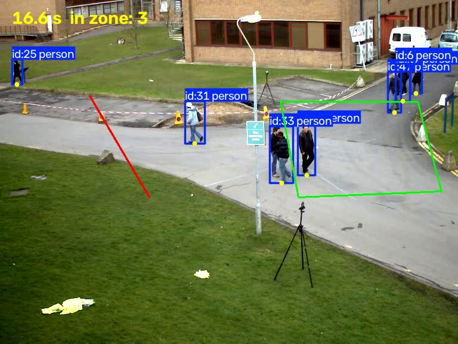
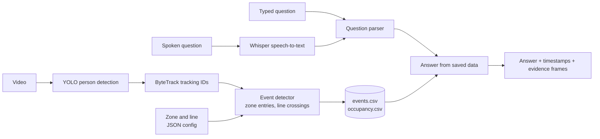

# SceneSift

SceneSift finds people in a video, records when they enter a marked zone or
cross a line, and answers typed or spoken questions about those events with
timestamps and matching frames as evidence.



*Each person gets a tracking ID. The yellow dot at their feet decides whether
they're inside the green zone or have crossed the red line.*

**Ask:** "When did someone cross the line?"
**Answer:** "14 line crossings: 18.5 s (ID 31, right to left), 20.4 s (ID 33,
right to left), ..." with a frame from each moment.

## What it does

1. **Place a zone and/or a line** by clicking on a frame of the video.
2. **Analyze:** YOLO detects people in every frame, ByteTrack follows each
   person with an ID, and SceneSift records zone entries, line crossings, and
   how many people are in the zone at every moment.
3. **Ask** by typing or speaking:
   - "When did someone enter the zone?"
   - "When did someone cross the line?"
   - "How many people were in the zone at 0:23?"
4. **Get an answer** with timestamps, track IDs, and evidence frames.

Questions are answered from the saved analysis in milliseconds, so the video
is only processed once. Speech is transcribed locally with Whisper, so audio
never leaves the computer.

## How it works



The slow part (detection and tracking) runs once per video and saves its
results. Questions only filter the saved data, which is why answers are
instant and spoken questions reuse the same logic as typed ones.

| Part | File | Notes |
|---|---|---|
| Geometry | `src/geometry.py` | Point in zone, side of line, segment crossing |
| Events | `src/events.py` | Tracks state per person; requires 5 frames inside before counting an entry |
| Analysis | `src/analyze_video.py` | Detection, tracking, events, annotated video; uses the GPU if available |
| Questions | `src/questions.py` | Keyword and time parsing, answers from saved data; no language model |
| Speech | `src/ask_voice.py` | faster-whisper `base.en`, running locally |
| Interface | `src/app.py` | Gradio web app for the whole workflow |
| Benchmarks | `src/benchmark.py` | Speed, memory, and event quality under different settings |

## Results

**Accuracy.** I checked 15 events in a 20-second window against the video by
hand. 9 were clearly correct, 5 were people hovering at the zone edge or
stopping on the line, and 1 had overlapping IDs. Requiring 5 frames inside
before counting an entry removed the two most questionable entries without
losing real ones. Details: [docs/event_review.md](docs/event_review.md).

**Tracking.** The tracker created 45 IDs for about 10 people, mostly when
people were hidden behind a lamppost or each other. Examples with frames:
[docs/tracking_errors.md](docs/tracking_errors.md).

**Speed** (79.5 s sample video, laptop with RTX 1000 Ada GPU):

| Setting | Speed | Events found |
|---|---|---|
| CPU | 1.1–1.3x real time | 39/39 (baseline) |
| **GPU (default when available)** | **1.9–2.2x real time** | **39/39** |
| CPU, 320 px input | 1.9x real time | 35/39 |
| CPU, every 2nd frame | 2.0x real time | 33/39 |

Spoken questions take 1–2.5 s to transcribe; answering takes 0.02 ms. Full
results: [docs/benchmarks.md](docs/benchmarks.md).

## Known limitations

- **IDs break when people are hidden.** A person behind an obstacle or
  another person often comes back with a new ID, which can cause a missed or
  misattributed entry. People who leave the camera view and return always get
  a new ID.
- **People standing on a zone edge** can still create false entries if they
  stay there longer than 0.5 s. Zone placement matters.
- **Line crossings have no tolerance yet.** Someone who stops on the line
  and turns back counts as two crossings.
- **Thresholds are in frames, not seconds.** The 5-frame entry rule is 0.5 s
  at 10 fps but only 0.17 s at 30 fps.
- **Only three question types,** in English. Spoken numbers must be
  transcribed as digits ("10 seconds") to be understood. Anything else gets a
  clear "can't answer that yet" message.
- **Tested on one sample video,** and accuracy was checked by hand on a
  20-second window. Missed events weren't measured.
- One video, one zone, and one line at a time. Windows setup only.

## Setup (Windows, PowerShell)

Requires Git and Python (tested with Python 3.14 on Windows 11).

```powershell
git clone https://github.com/kylahazelwork-ux/SceneSift.git
cd SceneSift
py -m venv .venv
.\.venv\Scripts\Activate.ps1
python -m pip install -r requirements.txt
```

If activation fails with "running scripts is disabled", run
`Set-ExecutionPolicy -Scope CurrentUser RemoteSigned` once, then activate again.

Download the sample video (videos are not stored in Git):

```powershell
Invoke-WebRequest -Uri https://raw.githubusercontent.com/opencv/opencv/4.x/samples/data/vtest.avi -OutFile sample_videos\vtest.avi
```

**Optional, for an NVIDIA GPU:** install the CUDA build of PyTorch. SceneSift
uses the GPU automatically when PyTorch can see one. Pick the build that
matches the CUDA version shown by `nvidia-smi`, for example:

```powershell
python -m pip install --force-reinstall --no-deps torch==2.14.1+cu132 torchvision==0.29.1+cu132 --index-url https://download.pytorch.org/whl/cu132
```

The first run downloads the YOLO weights (`yolo26n.pt`, about 5 MB) and, for
spoken questions, the Whisper `base.en` model (about 150 MB).

## Usage

**Interface** (recommended): opens in your browser at http://127.0.0.1:7860.

```powershell
python src/app.py
```

**Command line:**

```powershell
# Analyze: saves outputs/events.csv, outputs/occupancy.csv, outputs/analyzed.mp4
python src/analyze_video.py sample_videos/vtest.avi config/vtest_regions.json

# Ask typed questions (or run with no question for interactive mode)
python src/ask.py "When did someone enter the zone?"
python src/ask.py "How many people were in the zone at 0:23?"

# Ask a spoken question from a recording (for example, from Windows Sound Recorder)
python src/ask_voice.py sample_audio/question.m4a
```

**Tests:**

```powershell
python -m pytest
```

**Step-by-step scripts** from building the project, each runnable on its own:
`video_info.py` (video properties), `detect_video.py` (detection only),
`track_video.py` (tracking with a track summary), `preview_regions.py` (draw
the zone and line), `review_events.py` (images for checking events by hand),
and `benchmark.py`.

## Documentation

- [Scope and definitions](docs/scope.md): what version 1 supports and exactly
  what counts as an entry, crossing, or count
- [Design decisions](docs/decisions.md): what was chosen, why, and what was
  rejected
- [Tracking errors](docs/tracking_errors.md): where tracking fails, with frames
- [Event review](docs/event_review.md): events checked against the video, and
  the fix that followed
- [Benchmarks](docs/benchmarks.md): speed, memory, and quality under
  different settings

## Built with

OpenCV, Ultralytics YOLO (`yolo26n`), ByteTrack, faster-whisper, Gradio,
PyTorch, and pytest. Sample video from the OpenCV repository.
