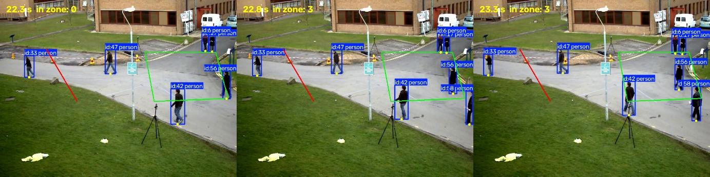
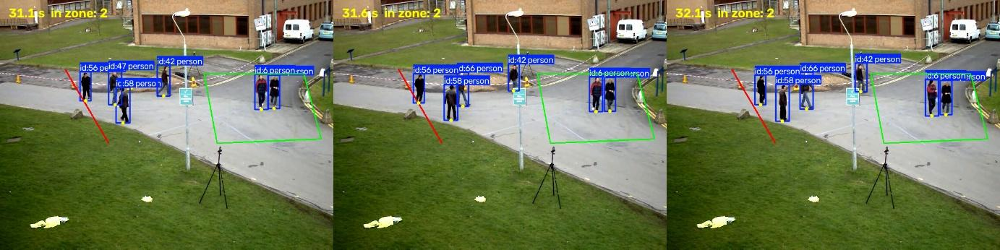

# Event review (Step 7)

I checked the program's events against the video by eye, to find out which
events are real, which are false, and why.

## Method

- **Window:** 15–35 s of `sample_videos/vtest.avi` (20 seconds, 15 events).
- **Setup:** `yolo26n`, ByteTrack defaults, zone and line from
  `config/vtest_regions.json`.
- **Process:** `src/review_events.py` saves one image per event showing the
  annotated video 0.5 s before, at, and 0.5 s after the event. I marked each
  one as real, edge case, or unsure.

```powershell
python src/analyze_video.py sample_videos/vtest.avi config/vtest_regions.json
python src/review_events.py 15 35
```

## Results

| Verdict | Count | Events |
|---|---|---|
| Real: the person clearly entered or crossed | 9 | 2, 4, 5, 6, 7, 10, 11, 14, 15 |
| Edge case: the person was hovering at the boundary | 5 | 3, 8, 9, 12, 13 |
| Unsure: overlapping labels, unclear which person | 1 | 1 |

**9 of 15 events (60%) were clearly correct.** Missed events (people who
entered or crossed without an event) were not checked in this pass.

## What it gets right

- People who walk clearly into the zone or across the line are detected,
  with the right ID and direction.
- No events came from non-people (the detector only tracks people).
- Someone already inside the zone when first detected does not create an
  entry, as designed.

## Where it fails

### 1. People standing on the zone edge create entries



At 22.8 s, a group of people is standing still on the top edge of the zone.
Their foot points wobble a few pixels across the edge, so "in zone" jumps
from 0 to 3 and entries are recorded even though nobody walked in. ID 6
produced 5 entries over the whole video this way (4.2, 9.3, 14.7, 16.3, and
22.8 s).

### 2. A person who stops at the line and turns back creates two crossings



ID 56 walks up to the line, pauses on it, and turns around. The foot point
crosses the line and comes back, giving a `right_to_left` crossing at 31.3 s
and a `left_to_right` crossing at 31.6 s.

### 3. Overlapping people make IDs hard to verify

Event 1 is an entry for ID 7, but the labels overlap so much that the person
appears to be ID 33. This is the same tracking problem described in
`tracking_errors.md`.

## Why it fails

The code follows the event rules exactly. The problem is the rules: a single
frame on the other side of an edge counts as an event, with no tolerance.
Detection boxes jitter by a few pixels every frame, so anyone close to an
edge can trigger events without moving. This was predicted in decision #2.

## Fix: require several frames inside before counting an entry

`EventDetector` now only counts a zone entry after the foot point stays
inside for `min_frames` frames in a row. If it goes back outside first, the
count resets. The entry time reported is when the entry is confirmed (the
last of those frames), about 0.4 s after the person stepped in.

**Why the confirmation time:** I first reported the step-in time, but then
"When did someone enter?" and "How many were in the zone?" disagreed for
0.4 s, because occupancy only counts confirmed entries. I found this in
Step 8 by comparing the two answers against each other. Reporting the
confirmation time keeps them consistent; a regression test now checks it.

To choose the value, I saved the tracks once and replayed only the event
logic with different settings, which took seconds instead of re-running
tracking each time.

| `min_frames` | Time at 10 fps | Entries (whole video) | Effect in the reviewed window |
|---|---|---|---|
| 1 (old rule) | 0.1 s | 33 | baseline |
| 3 | 0.3 s | 30 | no change |
| **5 (chosen)** | **0.5 s** | **25** | removed event 1 (unsure) and event 3 (edge case); kept all 5 real entries |
| 10 | 1.0 s | 23 | no further change |
| 15 | 1.5 s | 20 | removed event 4, a real entry |

**Result:** 5 frames removed the two questionable entries without losing any
real ones. Higher values start dropping real entries.

**What it didn't fix:** events 8 and 9 (IDs 17 and 6 at 22.7–22.8 s) remain
even at 15 frames. Those people didn't jitter; they stood on the zone's top
edge for several seconds. That's a zone placement problem: the edge runs
through a spot where people wait. Moving the zone's top edge would fix it.

## Remaining fixes (not done yet)

- **Line crossings:** apply the same idea. Only count a crossing once the
  person stays on the new side for several frames, so stopping on the line
  and turning back (events 12 and 13) doesn't count twice.
- **Zone placement:** move the zone's top edge away from where people stand.

Each fix trades responsiveness for stability: it removes false events but
adds a short delay, and could miss someone who steps in and out quickly.
