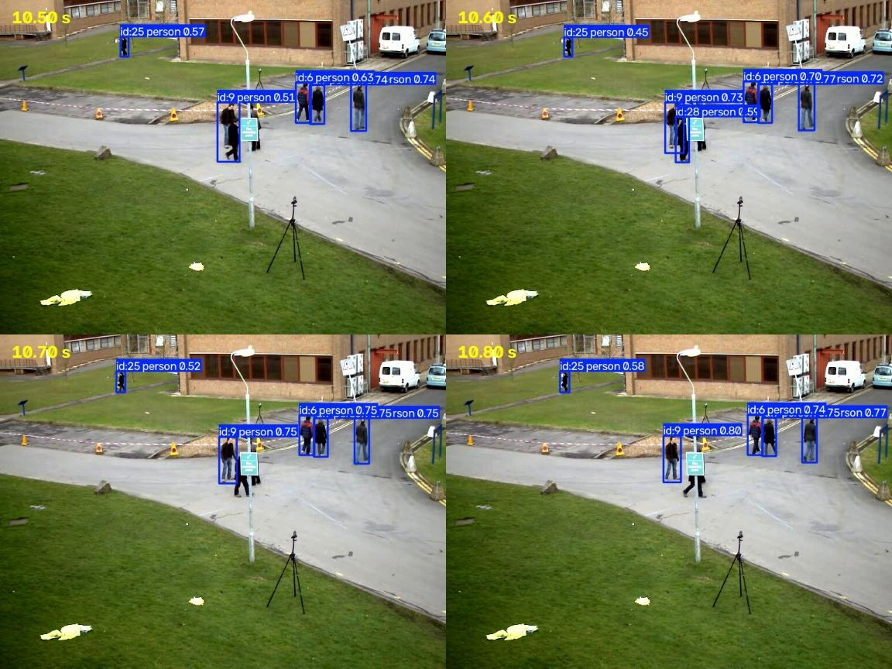
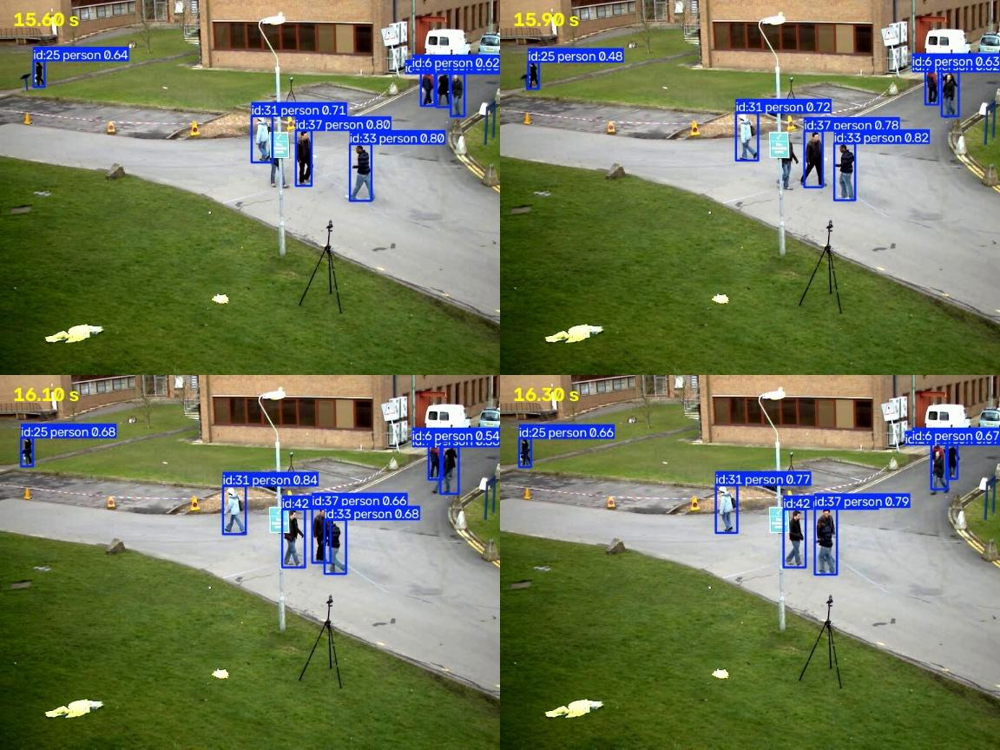
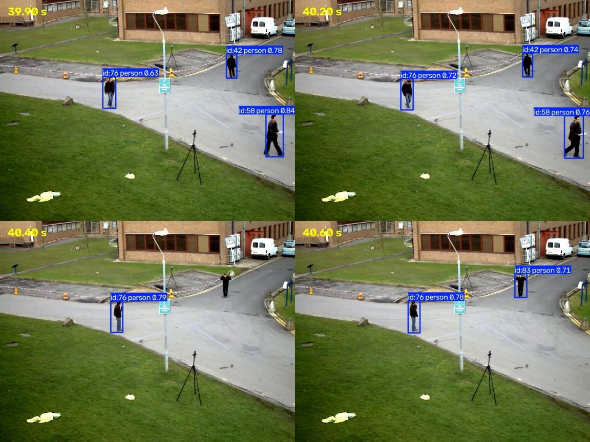

# Tracking errors (Step 5)

Results from running `src/track_video.py` on `sample_videos/vtest.avi`
(79.5 s, 10 fps) with YOLO `yolo26n` and ByteTrack's default settings.

## Summary

| Measure | Value |
|---|---|
| Real people (rough estimate from watching) | about 10 |
| Unique track IDs created | 45 |
| Tracks shorter than 1 second | 8 |
| Single-frame tracks (0.0 s) | 6 |

About 4–5 IDs per real person. Some of that is expected: someone who leaves
the camera view and comes back gets a new ID, because the tracker has no way
to recognize a person it stopped seeing. The rest is tracking errors.

Note: the highest ID number (178) is not a people count. ByteTrack uses up an
ID for every candidate track, including ones that are discarded.

## Examples

Each image shows four frames in order: top-left, top-right, bottom-left,
bottom-right.

### 1. Occlusion causes a one-frame track (ID 28, 10.6 s)

- **What happened:** Two people walk past the lamppost overlapping each
  other. At 10.5 s one box (ID 9) covers both of them. At 10.6 s the second
  person briefly gets their own box (ID 28), then loses it again at 10.7 s
  and stays undetected while walking past.
- **Why:** The second person is partly hidden by person 9 and by the
  lamppost sign, so the detector only finds them in one frame.
- **Type:** Missed detection caused by occlusion, which shows up as a
  single-frame track.

### 2. Person hidden by the lamppost gets a new ID (ID 42, 16.1 s)

- **What happened:** A person walks behind the lamppost sign while next to
  two other people (IDs 31 and 37). They have no box at 15.6 s and 15.9 s,
  then appear as a new ID 42 at 16.1 s once they're past the sign.
- **Why:** The lamppost and nearby people hide most of their body, so they
  aren't detected until they come out. ID 33 is also briefly hidden behind
  ID 37 at 16.3 s.
- **Type:** Occlusion by a fixed object and by other people.

### 3. A pose change causes an ID switch (ID 42 → ID 83, 40.3–40.6 s)

- **What happened:** The person tracked as ID 42 raises their arm at 40.4 s
  and isn't detected in that frame. At 40.6 s the same person is detected
  again but gets a new ID, 83.
- **Why:** Lost tracks are kept for 30 frames (3 s at 10 fps), so the old ID
  was still available. But the raised arm changed the box's shape and
  position, so it didn't overlap enough with where ByteTrack predicted ID 42
  would be, and ByteTrack started a new track instead.
- **Type:** ID switch after a brief missed detection.

**Not an error:** ID 58 also ends at 40.3 s, almost when ID 83 starts. But
the frames show ID 58 is a different person walking out of the bottom-right
of the frame. Matching timestamps alone don't prove an ID switch.

## What this means for SceneSift

- **Zone entries:** If a person gets a new ID while inside the zone, the new
  ID is "first detected inside" and won't count as an entry, so the entry is
  missed. If they get a new ID outside and then walk in, the entry still
  counts, but it's attributed to the wrong ID.
- **Line crossings:** A crossing needs the same ID on both sides of the line.
  An ID switch right at the line (like near the lamppost) loses the crossing.
- **Person counts:** Counting occupancy at one moment (decision #3) is only
  affected by missed detections in that frame, not by ID switches. This is
  why occupancy was chosen over counting unique visitors.

## Possible improvements (not done yet)

- Place the zone and line away from the lamppost, where occlusion is common.
- Tune ByteTrack settings (for example, `match_thresh` or `track_buffer`) and
  compare the number of IDs created.
- Try a larger YOLO model, which may detect partly hidden people better.
- Measure the effect of each change in Step 7 instead of guessing.
